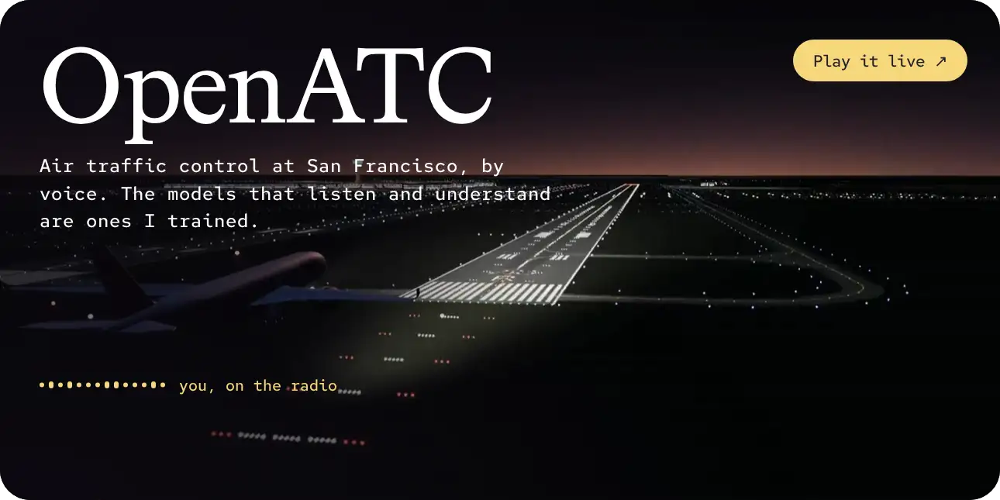
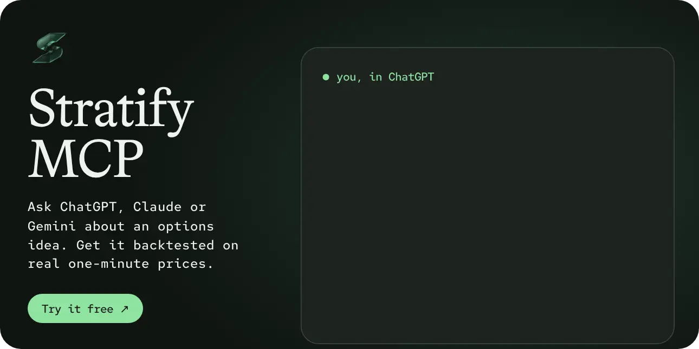
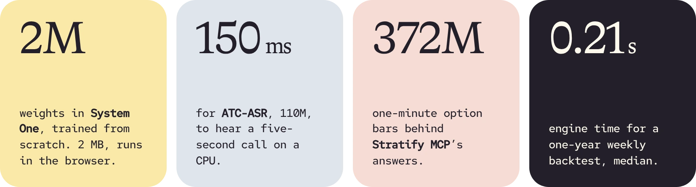

<picture>
  <source media="(max-width: 600px)" srcset="assets/hero-phone.webp">
  
</picture>

  &nbsp;
  &nbsp;
  &nbsp;
  

I take a product from the first sketch to production, and when it needs a model small enough to run in a browser tab, I train that too. These two are mine, live, and MIT licensed.

<a href="https://openatc.aeon-labs.site">
<picture>
  <source media="(max-width: 600px)" srcset="assets/openatc-phone.webp">
  
</picture>
</a>

Key the mic and talk to the traffic. A speech model I fine-tuned hears you, a 2M model I trained from scratch works out the command, and the pilot reads it back and flies it. No large language model and no GPU at run time.

**[Play](https://openatc.aeon-labs.site)** · **[Code](https://github.com/Srinath-exe/OpenSkyATC)** · **[Speech model](https://huggingface.co/srinath-exe/skycontrol-atc-asr-110m)** · **[Command model](https://huggingface.co/srinath-exe/skycontrol-atc-command-2m)**

<a href="https://stratify.aeon-labs.site">
<picture>
  <source media="(max-width: 600px)" srcset="assets/stratify-phone.webp">
  
</picture>
</a>

Describe an options strategy in plain words and get it backtested on real one-minute NIFTY and SENSEX prices, after every charge. Then it tells you how far to trust the result.

**[Try it](https://stratify.aeon-labs.site)** · **[Code](https://github.com/Srinath-exe/stratify-mcp)** · **[npm](https://www.npmjs.com/package/stratify-mcp)** · **[PyPI](https://pypi.org/project/stratify-mcp/)** · **[MCP Registry](https://registry.modelcontextprotocol.io/v0.1/servers?search=site.aeon-labs/stratify)**

### Measured

<picture>
  <source media="(max-width: 600px)" srcset="assets/numbers-phone.webp">
  
</picture>

150 ms: median of 320 clips, 2 CPU threads. 0.21 s: one request at a time on the 8-core server, August 2026.

### Built with

<picture>
  <source media="(max-width: 600px)" srcset="assets/stack-phone.svg">
  
</picture>
